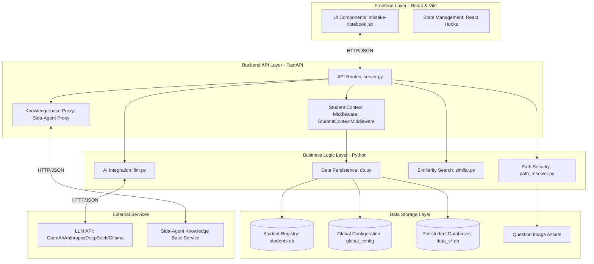

# 🎓 Smart Mistake Lab

🌐 [简体中文](README.md) | [English](README.en.md)

An AI-powered, multi-subject mistake notebook for organizing and reviewing incorrect answers. It supports **mathematics, physics, chemistry, English, and Chinese**. Scan a local image folder and let AI extract question text and suggest subject-specific tags. Edit solutions, track study progress, and get reminders for questions that need more practice.

<div align="center">

https://github.com/user-attachments/assets/1de530cd-a875-4edb-957f-4757d01ee6d7

</div>

**Highlights**

- 🤖 **AI recognition** — Extracts question text, knowledge-point tags, solution approaches, and difficulty. Titles are edited by the user.
- 📂 **Automatic subject classification** — Subjects are inferred from the folder structure.
- 💡 **Subject-specific knowledge** — 100+ core knowledge points for each subject; physics, mathematics, and chemistry also include junior-high-school exam topics, solution models, and common-mistake reminders (209/50, 211/169, and 67/43 respectively).
- 🔍 **Powerful search** — Filter by keywords, tags, dates, and mastery.
- 📌 **Focus practice** — Mark questions for focused review and receive overdue reminders and encouraging messages.
- 👨‍👩‍👧 **Multiple student profiles** — Keep each student's notebook separate and view AI usage for the whole family.
- 📊 **Study tracking** — Track practice counts, mastery, and difficulty.
- 💾 **Local storage** — Metadata is stored in SQLite; question and solution images stay in their image folders.
- 📚 **Subject knowledge-base Q&A** — Integrates with [sida-agent](https://github.com/wubo0067/sida-agent) for textbook Q&A, page citations, and original-page images. See [Knowledge-base integration](#-knowledge-base-integration-sida-agent).

## Features

### Subject folders

- The first-level subfolders under the configured image directory are treated as subjects. Use the built-in folder names `数学/`, `物理/`, `化学/`, `英语/`, and `语文/` to match the supported subject knowledge lists and preset order.
- AI analysis uses the knowledge-point list for the detected subject.
- The notebook displays a separate tab and count for each subject.
- Tabs are ordered Mathematics → Physics → Chemistry → English → Chinese; other subject folders are sorted by name, and unclassified images appear last.

### Mistake notebook

- Scan a local folder for JPG, PNG, GIF, WebP, and BMP images and group them by subject.
- Track whether each image is indexed or still pending; refresh the scan after adding images.
- Analyze a pending image with AI to extract the question text, solution approach, tags, and difficulty. The title is user-editable.
- Store extracted question text in its own field for review and search.
- Add, edit (double-click a tag), or remove tags.
- Search indexed questions by subject, tag, mastery, keyword (title, question text, tags, and notes), and date range.
- Group the notebook by day, week, or month.
- Manage a Focus Practice list on its own page. The default limit is 10 questions per subject and can be changed in settings. Overdue items are highlighted.
- Find similar questions from an indexed question or pasted question text; optionally use a text model for semantic reranking.
- Keep image files in their original folders while storing their metadata in SQLite.

### Solutions and image management

- Edit a text solution or explanation for each question.
- Paste solution images from the clipboard with Ctrl+V, or upload them from the local computer.
- Double-click a solution thumbnail to view the original image. Close the preview with the overlay, close button, or Esc.
- Delete individual solution images.
- Solution text and image changes are saved automatically.
- Solution images are named `{original_filename}_sol_{number}.{extension}`.
- **Remove from index** removes only the notebook record; the question image and solution images are retained and can be indexed again.
- **Permanently delete** removes the record and all associated question and solution images. This cannot be undone. A confirmation dialog requires you to choose the deletion method.

### Study tracking and Focus Practice

- Set mastery to mastered, unfamiliar, or keep practicing.
- Rate difficulty from 1 (easy) to 5 (hard); the default is 3.
- Track the number of practice attempts and the most recent practice time.
- Add free-form notes to each question.
- Mark questions for Focus Practice. The default limit is 10 per subject and is configurable.
- If a focus question has not been practiced within the configured time threshold, the Focus Practice page shows a reminder and highlights it with a red border.
- The Focus Practice page shows the number of selected questions, overdue status, and time since the last practice. Remove a question from the list from its detail view.

### Multiple student profiles

Designed for families with multiple students. Each student has an independent notebook, Focus Practice list, image-folder configuration, and AI token statistics.

- Switch students using the selector beside the page title; page data reloads for the selected student.
- Each student has a separate SQLite database (`server/data_s<id>.db`), isolating questions, tags, solutions, and practice records.
- Image-folder and Focus Practice timeout settings are stored per student.
- Add, rename, or delete students in settings. Deleting a student removes their database but keeps image files. The last remaining student cannot be deleted.
- AI token statistics can show the current student or a family-wide total with a per-student breakdown.
- On upgrade, the existing `data.db` is automatically registered as the “Default” student; no data migration is needed.
- Requests carry the selected student identity in a header or query parameter, so different devices can use the same backend and remember their selected student.

> ⚠️ Student switching does not require a password. This is intended for trusted home or local-network environments.

## 📚 Knowledge-base integration (sida-agent)

In addition to organizing students' own mistake images, the app includes a **Knowledge Base** tab that integrates with the separate open-source project [wubo0067/sida-agent: a middle-school science knowledge-base Q&A agent](https://github.com/wubo0067/sida-agent).

sida-agent extracts middle-school physics, chemistry, and mathematics textbooks or handouts from PDFs with vision and reasoning models, then builds a knowledge graph and vector database. It can answer questions with explanations traceable to textbook page numbers. Smart Mistake Lab helps students **practice** their own mistakes; sida-agent helps them **learn** concepts, look up formulas, and view textbook pages. Answers can include the relevant original textbook images.

### Features

- **Multi-turn Q&A** — Continue conversations in the Knowledge Base → Chat page. Sessions persist by `thread_id` and can be reopened. Answers stream over SSE, and model reasoning can be expanded or collapsed.
- **Formula rendering and citations** — KaTeX renders `$...$` and `$$...$$` formulas. Explanations cite a textbook and page number.
- **Textbook page images** — Related page images appear as a thumbnail row. Open and navigate the full-size images with buttons or ←/→ keys; zoom with the mouse wheel, drag to pan, or view at 1:1.
- **Textbook list** — The Textbooks page lists imported books and their `pdf_id`.
- **Import/build a knowledge base** — Browse local folders to select a textbook PDF or paste an absolute path, then specify the page range and subject. A read-only estimate predicts the number of vision/reasoning model calls without invoking a model. After confirmation, SSE shows page/sub-chunk progress and actual token usage. Builds can resume and their task history can be reviewed.
- **Same-origin proxy** — The frontend calls this app's `/api/agent/*` endpoints; the backend forwards requests to sida-agent with httpx. Configuration changes take effect immediately and do not rely on upstream CORS.

### Configuration

1. Start the sida-agent service (its Python environment must be prepared separately). From the `sida-agent` directory, run:

   ```bash
   uv run python main.py --stage serve --host 127.0.0.1 --port 6173
   ```

   If the knowledge base has not been built yet, use `--stage build` or import PDFs from this app's Knowledge Base → Import page. For sida-agent installation, `.env` (vision/reasoning model keys), and build details, see its [README](https://github.com/wubo0067/sida-agent).

2. In Smart Mistake Lab, open **Settings & Stats** → **Knowledge Base Service (sida-agent)** and set:

   | Field | Default | Description |
   | --- | --- | --- |
   | Host | `127.0.0.1` | sida-agent host; for LAN access, use an address such as `http://192.168.1.10`. |
   | Port | `6173` | The port passed to sida-agent's `--port` option. |

   Save the configuration to test the connection automatically, or select **Test connection**. A successful connection displays the graph-node and vector counts.

   > This is a global setting stored in the `global_config` table in `server/students.db`. It is shared by all students, takes effect immediately, and does not require a backend restart.

3. Open the **Knowledge Base** tab to start a chat or import textbooks.

### Proxy API

The backend in `server/server.py` forwards these `/api/agent/*` endpoints to sida-agent:

| Method | Path | Description |
| --- | --- | --- |
| GET | `/api/agent/health` | Connection check and graph/vector counts |
| GET | `/api/agent/books` | List imported textbooks |
| GET | `/api/agent/chat/sessions?limit=&offset=` | Paginated session list (`total` and `has_more` included) |
| POST | `/api/agent/chat/sessions` | Create a session and return `thread_id` |
| GET | `/api/agent/chat/sessions/{id}` | Get a session's message history |
| POST | `/api/agent/chat/sessions/{id}/messages` | Send a question and stream tokens, reasoning, and results over SSE |
| POST | `/api/agent/build/estimate` | Read-only estimate; does not invoke models |
| POST | `/api/agent/build` | Submit a build task; returns 409 if a new estimate requires confirmation |
| GET | `/api/agent/build/tasks` | List build-task history |
| GET | `/api/agent/build/tasks/{id}` | Get a build task's status |
| GET | `/api/agent/build/tasks/{id}/events` | Stream per-page/sub-chunk build progress over SSE |

The app also provides two **local file-browser** endpoints, not proxied to sida-agent: `GET /api/fs/roots` lists available drives/home directories, and `GET /api/fs/list?path=<absolute path>` lists subdirectories and PDF files. They let the import page browse for local files when the browser cannot provide absolute paths. Only names, paths, and sizes are returned; file contents are not read. This is intended for local or trusted-LAN use.

> If the Knowledge Base page cannot connect, confirm sida-agent is running and the configured Host/Port match, then retry **Test connection**. If textbook thumbnails do not load, sida-agent may not have static `/pdf_images` serving enabled for `--stage serve`, or its `.env` may lack a publicly reachable image base URL.

## Architecture



- **Subject folders** — First-level subfolders determine the subject; AI analysis uses that subject's knowledge-point list.
- **Backend API layer** — FastAPI routes handle requests; student-context middleware routes data requests to the selected student's database; the knowledge-base proxy forwards requests to sida-agent over HTTP/JSON.
- **Business logic** — `db.py` manages persistence, `llm.py` handles AI requests and subject-specific prompts, `similar.py` searches for similar questions, and `path_resolver.py` resolves image paths.
- **External services** — **The subject knowledge base is a key service provided by sida-agent.** The backend knowledge-base proxy connects to sida-agent over HTTP/JSON, enabling textbook Q&A, knowledge retrieval, page citations, and original textbook images. Separately, `llm.py` calls LLM APIs such as OpenAI, Anthropic, DeepSeek, and Ollama for mistake analysis and other AI features.
- **Data storage** — `students.db` stores the student registry and global settings, `data_s*.db` isolates each student's mistakes, and image assets remain in the configured image folders.
- **Frontend** — Handles presentation and interaction; it contains no AI or API-key logic.
- **Vite proxy** — Forwards `/api` requests to the backend in development to avoid cross-origin issues.
- **Student routing** — `students.db` stores the student registry. Middleware routes each request to that student's SQLite database using `X-Student-Id` or `?sid=`; concurrent requests remain isolated.

## Technology stack

| Layer | Technology |
| --- | --- |
| Frontend | React + Vite |
| Backend | Python FastAPI + Uvicorn |
| AI requests | Python httpx (`server/llm.py`) |
| Logging | Python logging + RotatingFileHandler (`server/log.py`) |
| Database | SQLite via Python `sqlite3` |
| AI APIs | Image-capable OpenAI Chat Completions, Anthropic Messages, and Ollama (including local OpenAI-compatible services such as Atomic Chat and LM Studio) |

## 🚀 Quick start

### Prerequisites

| Component | Requirement | Description |
| --- | --- | --- |
| Node.js | ≥ 20.19 or ≥ 22.12 | Required by Vite 7; Node 20 must be at least 20.19. |
| npm | ≥ 9 | Frontend package manager |
| Python | ≥ 3.10 | Backend runtime (managed by uv) |
| uv | Latest | Python package and virtual-environment manager |
| AI service | — | An image-capable service such as OpenAI, Claude, Ollama, or Atomic Chat |

### Install uv

The backend uses [uv](https://docs.astral.sh/uv/) to manage its Python environment and dependencies. Install it if needed:

**Windows (PowerShell)**

```powershell
powershell -ExecutionPolicy ByPass -c "irm https://astral.sh/uv/install.ps1 | iex"
```

**macOS / Linux**

```bash
curl -LsSf https://astral.sh/uv/install.sh | sh
```

Open a new terminal and verify with `uv --version`. See the [official uv installation guide](https://docs.astral.sh/uv/getting-started/installation/) for other methods such as `pip`, `pipx`, `winget`, and `scoop`.

### Step 1: Clone the project and install dependencies

```bash
git clone https://github.com/wubo0067/Smart-Mistake-Lab.git
cd Smart-Mistake-Lab

# Install frontend dependencies
npm install

# Create server/.venv and install backend dependencies
cd server
uv sync
cd ..
```

- `npm install` installs React, Vite, and other dependencies from the root `package.json`.
- `uv sync` creates `server/.venv` and installs dependencies from `server/pyproject.toml` (FastAPI, Uvicorn, httpx, python-dotenv). The first run may download Python and packages, so an internet connection is required.
- Use `uv run python server.py` to start the backend; manual virtual-environment activation is not required. The launcher scripts use uv as well.
- Run `uv sync` again after dependency manifests change.
- Run `npm run dev` from the project root, where `package.json` is located.

### Step 2: Configure AI services

Create or edit `.env` in the project root. The two services can be configured independently; keys stay in `.env`.

```env
# Image question extraction (vision model required)
IMAGE_ANALYSIS_AI_API_URL=http://localhost:11434
IMAGE_ANALYSIS_AI_MODEL=llava
IMAGE_ANALYSIS_API_KEY=sk-your-image-analysis-api-key

# Solution analysis (text model; image input not required)
PROBLEM_AI_API_URL=http://localhost:11434
PROBLEM_API_MODEL=qwen2.5
PROBLEM_API_KEY=sk-your-problem-analysis-api-key
```

> **Important:** `IMAGE_ANALYSIS_*` must use a vision-capable model (such as GPT-4 Vision, Claude, or LLaVA). `PROBLEM_*` only needs text input support and can use a less expensive model or one better suited to structured output. See [AI configuration](#ai-configuration-env) for formats and examples.

### Step 3: Start the app (recommended)

**Windows (PowerShell)**

```powershell
.\start.ps1
```

**Windows (Command Prompt)**

```cmd
start.bat
```

**Linux / macOS**

```bash
chmod +x start.sh
./start.sh
```

Install Node.js, npm, and uv before starting. The scripts do not behave identically: `start.sh` checks Node.js/uv and installs missing `node_modules` or backend virtual-environment dependencies; `start.bat` checks Node.js and attempts to install missing dependencies; `start.ps1` does not check or install dependencies. The default backend port is 8765 and the frontend port is 5173.

When startup completes, open **`http://127.0.0.1:5173`** in a browser.

#### Advanced options

Specify the host IP for LAN access:

```powershell
# Windows PowerShell
.\start.ps1 --ip 192.168.1.10

# Windows CMD
start.bat --ip 192.168.1.10

# Linux/macOS
./start.sh --ip 192.168.1.10
```

| Option | PowerShell (`start.ps1`) | Linux/macOS (`start.sh`) | Windows CMD (`start.bat`) |
| --- | --- | --- | --- |
| `--ip <address>` | Supported | Supported | Supported |
| `--no-frontend` (backend only) | Supported | Supported | Not supported |
| `--no-backend` (frontend only) | Supported | Supported | Not supported |
| `--port <port>` | Not supported | Not supported | Not supported |

To set a custom backend port, run `cd server` followed by `uv run python server.py --port <port>`, and update the API proxy target in `vite.config.js`. `--ip` must be an IP address assigned to the local machine, not the gateway address.

### Step 4: Start manually (development)

```bash
# Terminal 1: backend at http://127.0.0.1:8765
cd server
uv run python server.py

# Terminal 2: frontend at http://localhost:5173
npm run dev
```

The Vite development server proxies `/api` requests to the backend.

### Production deployment

Build and preview the frontend:

```bash
npm run build      # outputs to dist/
npm run preview    # previews the production build locally
```

Deployment considerations:

1. Keep the backend running (for example, under systemd or supervisor).
2. Configure Nginx/Apache to proxy `/api` requests to the backend.
3. Configure SSL/TLS for production HTTPS.
4. Configure AI service variables in `.env` on the server.

Example Nginx configuration:

```nginx
server {
    listen 80;
    server_name example.com;

    location / {
        root /path/to/dist;
        try_files $uri $uri/ /index.html;
    }

    location /api {
        proxy_pass http://127.0.0.1:8765;
        proxy_set_header Host $host;
        proxy_set_header X-Real-IP $remote_addr;
    }
}
```

## Configuration

### Image folders and subject classification

On the app's **Settings** page, set the folder containing mistake images, for example:

```text
C:\Users\me\Pictures\Mistakes
```

The folder path is stored in the backend's SQLite database and persists across restarts. In multi-student mode, each student has an independent setting. You can also configure the Focus Practice timeout threshold (48 hours by default).

The **first-level subfolder name** determines the subject. Use the built-in Chinese folder names shown below so that images use the corresponding subject-specific knowledge-point list:

```text
C:\Users\me\Pictures\Mistakes\
├── 数学\               ← Mathematics
│   ├── 01-Triangles\
│   │   ├── question1.jpg
│   │   └── question2.png
│   └── 02-Functions\
│       └── question3.jpg
├── 物理\               ← Physics
├── 化学\               ← Chemistry
├── 英语\               ← English
├── 语文\               ← Chinese
├── 未分类的题.png      ← Unclassified
└── cover.jpg           ← Unclassified
```

Deeper subfolders such as `数学/01-Triangles/` do not create additional subjects; their images belong to the first-level subject folder.

### AI configuration (`.env`)

The backend loads AI settings from the `.env` file in the project root (see `server/server.py`). The two independent configurations serve different tasks:

```env
# Image question extraction (vision model required)
IMAGE_ANALYSIS_AI_API_URL=https://your-vision-model-host/v1/chat/completions
IMAGE_ANALYSIS_AI_MODEL=your-vision-model
IMAGE_ANALYSIS_API_KEY=sk-your-image-analysis-api-key

# Solution analysis (text model)
PROBLEM_AI_API_URL=https://your-text-model-host/v1/chat/completions
PROBLEM_API_MODEL=your-text-model
PROBLEM_API_KEY=sk-your-problem-analysis-api-key

# Optional settings shared by both AI services
# AI_TIMEOUT=120
# AI_MAX_TOKENS=4096
```

LLM URLs, model names, and API keys are kept in `.env`; they are not exposed to the browser or stored in the database. Restart the backend after changing these settings.

| Variable | Required | Default | Description |
| --- | --- | --- | --- |
| `IMAGE_ANALYSIS_AI_API_URL` | Yes | — | Image question extraction endpoint (vision model) |
| `IMAGE_ANALYSIS_AI_MODEL` | Yes | — | Model used for image question extraction |
| `IMAGE_ANALYSIS_API_KEY` | Depends on service | — | Image analysis API key; may be blank for Ollama |
| `PROBLEM_AI_API_URL` | Yes | — | Solution-analysis endpoint (text model) |
| `PROBLEM_API_MODEL` | Yes | — | Model used for solution analysis |
| `PROBLEM_API_KEY` | Depends on service | — | Solution analysis API key; may be blank for Ollama |
| `AI_TIMEOUT` | No | `120` | Timeout per AI request, in seconds |
| `AI_MAX_TOKENS` | No | `4096` | Maximum model output tokens; increase if logs report truncation |
| `AI_PROTOCOL` | No | `auto` | Override protocol detection: `auto`, `openai`, `ollama`, or `anthropic` |

`IMAGE_ANALYSIS_*` extracts the full question from an image and therefore requires vision input. `PROBLEM_*` generates a solution approach (`summary`), knowledge-point tags (`tags`), difficulty, and Focus Practice encouragement, and only needs text input.

#### Common model examples

**OpenAI-compatible services (GPT-4o, Qwen, GLM, SiliconFlow, vLLM, etc.)**

```env
IMAGE_ANALYSIS_AI_API_URL=https://api.openai.com/v1/chat/completions
IMAGE_ANALYSIS_AI_MODEL=gpt-4o
IMAGE_ANALYSIS_API_KEY=sk-xxxxxxxx

PROBLEM_AI_API_URL=https://api.openai.com/v1/chat/completions
PROBLEM_API_MODEL=gpt-4o-mini
PROBLEM_API_KEY=sk-xxxxxxxx
```

**DeepSeek**

```env
PROBLEM_AI_API_URL=https://api.deepseek.com
PROBLEM_API_MODEL=deepseek-flash
PROBLEM_API_KEY=sk-xxxxxxxx
```

**Anthropic Claude (vision and text)**

```env
IMAGE_ANALYSIS_AI_API_URL=https://api.anthropic.com/v1/messages
IMAGE_ANALYSIS_AI_MODEL=claude-sonnet-4-20250514
IMAGE_ANALYSIS_API_KEY=sk-ant-xxxxxxxx

PROBLEM_AI_API_URL=https://api.anthropic.com/v1/messages
PROBLEM_API_MODEL=claude-sonnet-4-20250514
PROBLEM_API_KEY=sk-ant-xxxxxxxx
```

**Local Ollama (no API key required)**

```env
IMAGE_ANALYSIS_AI_API_URL=http://localhost:11434
IMAGE_ANALYSIS_AI_MODEL=qwen3.6-flash

PROBLEM_AI_API_URL=http://localhost:11434
PROBLEM_API_MODEL=deepseek-v4-flash

# Local models may need more time, especially for image processing.
AI_TIMEOUT=600

# Reasoning models may consume many tokens before producing the final JSON.
AI_MAX_TOKENS=32768
```

For an 8K-context local model, reduce `AI_MAX_TOKENS` as needed (for example, to 4096). If a reasoning model is cut off before producing its final JSON, increase this value; the backend logs may report a `max_tokens` truncation or `finish_reason=length`.

**Local OpenAI-compatible services (Atomic Chat / LM Studio; no API key required)**

Although these services run locally, they use the OpenAI-compatible protocol, not Ollama's native API. Keep the `/v1` suffix in the Base URL:

```env
# Atomic Chat, default port 1337
IMAGE_ANALYSIS_AI_API_URL=http://127.0.0.1:1337/v1
IMAGE_ANALYSIS_AI_MODEL=qwen3.8:27b

PROBLEM_AI_API_URL=http://127.0.0.1:1337/v1
PROBLEM_API_MODEL=deepseek-r1:7b

AI_TIMEOUT=600
AI_MAX_TOKENS=32768
```

If using a bare URL without `/v1` (such as `http://127.0.0.1:1337`) or a different port, set `AI_PROTOCOL=openai` to explicitly add `/v1/chat/completions`.

#### Supported AI API formats

| Format | Authentication | Suitable services |
| --- | --- | --- |
| OpenAI-compatible `/v1/chat/completions` | `Authorization: Bearer` (may be blank) | Image-capable OpenAI-compatible services, including Atomic Chat and LM Studio |
| Anthropic `/v1/messages` | `x-api-key` + `anthropic-version` | Vision-capable Claude services |
| Ollama `/api/chat` | None | Local Ollama, for example `http://localhost:11434` |

The request format is detected from the URL in this order:

1. An explicit endpoint path takes priority: `/v1/messages` → Anthropic; `/api/chat` → Ollama; `/chat/completions` → OpenAI-compatible.
2. If `AI_PROTOCOL` is explicitly set to `openai`, `ollama`, or `anthropic`, use that protocol and complete its endpoint path. The default `auto` does not override detection.
3. A loopback URL with no path, such as `http://localhost:11434`, is treated as Ollama and gets `/api/chat`. `http://127.0.0.1:1337` (Atomic Chat) and `http://127.0.0.1:1234` (LM Studio) default to OpenAI-compatible.
4. Other Base URLs default to OpenAI-compatible and get `/v1/chat/completions`. If the Base URL already ends in `/v1`, only `/chat/completions` is appended, avoiding a duplicate `/v1/v1/`.

## Project structure

```text
Smart-Mistake-Lab/
├── index.html                  # HTML entry point
├── package.json                # Frontend dependencies and scripts
├── vite.config.js              # Vite config, including API proxy
├── .env                        # User-created environment variables
├── mistake-notebook.jsx        # Main app component, pages, and styles
├── start.ps1                   # Windows PowerShell launcher
├── start.bat                   # Windows CMD launcher
├── start.sh                    # Linux / macOS launcher
├── src/
│   ├── main.jsx                # React mount point
│   └── App.jsx                 # Component export
└── server/
    ├── pyproject.toml          # Project config and uv dependencies
    ├── server.py               # FastAPI entry point (REST API + image service)
    ├── db.py                   # SQLite operations, migrations, subject queries
    ├── llm.py                  # AI integration, prompts, API calls, response parsing
    ├── log.py                  # Console and rotating-file logging
    ├── similar.py              # Local similar-question search
    ├── path_resolver.py        # Image path resolution
    └── tests/                  # Backend unittest tests

Runtime data:
  server/data.db                # Default student's SQLite database
  server/students.db            # Student registry and global settings
  server/data_s<id>.db          # Other students' databases
  logs/server.log               # 10 MB log file; 5 backups retained
```

## API overview

| Method | Path | Description |
| --- | --- | --- |
| GET | `/api/health` | Health check |
| GET | `/api/config` | Get image folder, Focus Practice timeout, and `chat_session_page_size` |
| PUT | `/api/config` | Save these settings; `chat_session_page_size` defaults to 20 and has a maximum of 200 |
| GET | `/api/ai-config` | Get AI configuration status (URLs, model names, and whether keys are set; never returns key values) |
| PUT | `/api/ai-config` | Deprecated; LLM settings are managed only through `.env`, and writes have no effect |
| GET | `/api/scan` | Scan image folders and return indexed/pending images grouped by subject, including `subject_order` |
| GET | `/api/images/all` | Get indexed images; supports subject, query, mastery, and date filters |
| POST | `/api/images/index` | Index an image; infers the subject and accepts title, content, tags, difficulty, etc. |
| PUT | `/api/images/update` | Update image metadata, including solution, mastery, difficulty, and notes |
| DELETE | `/api/images/delete` | Remove an image from the index (`file_path`); keeps the file |
| DELETE | `/api/images/purge` | Remove the index and associated question/solution files (`file_path`) |
| GET | `/api/images/focus` | Get Focus Practice questions, count, and overdue status |
| PUT | `/api/images/focus` | Add/remove Focus Practice questions (default limit: 10 per subject; configurable) |
| POST | `/api/images/focus/reminders` | Generate encouragement for supplied focus questions, not only overdue ones |
| POST | `/api/images/find-similar` | Find similar questions by text or notebook question; optional AI reranking |
| POST | `/api/analyze` | Analyze an image; returns `{content, summary, tags, difficulty}` |
| POST | `/api/solution-image` | Upload a solution image using `{original_filename}_sol_{number}.{extension}` naming |
| DELETE | `/api/solution-image` | Delete a solution image by `path` |
| GET | `/api/timeline` | Get daily timeline records (`offset` paginates by day; day/week/month grouping belongs to the notebook view) |
| GET | `/api/image-file` | Serve an image by `path`; may include `sid` in multi-student mode |
| GET | `/api/fs/roots` | List local drives/home folders for textbook import |
| GET | `/api/fs/list` | List subfolders and PDFs for textbook import |
| GET | `/api/students` | Get student list and current student ID |
| POST | `/api/students` | Create a student (`name`) and their database |
| PUT | `/api/students/{id}` | Rename a student (`name`) |
| DELETE | `/api/students/{id}` | Delete a student and their database; keeps images; cannot delete the last student |
| GET | `/api/token-stats` | AI token usage; `scope=student` for current student or `scope=all` for the family total and per-student breakdown |

`/api/images/all` supports `subject` (empty means all), `query` (title/question text/tags/notes), `mastery` (`mastered`, `unfamiliar`, or `practice`), `date_enabled`, `start_date`, and `end_date` (`YYYY-MM-DD`). Its response includes `{items, total_count, filtered_count, subjects}`.

Except for `/api/students`, data endpoints route to a student database using the `X-Student-Id` request header. For contexts such as `` that cannot send a header, use the `?sid=` query parameter. Requests without an ID fall back to the first (default) student.

## Usage

### First-time setup

1. Organize images into subject folders as described in [Image folders and subject classification](#image-folders-and-subject-classification).
2. Start the app with a launcher script or start the frontend and backend separately.
3. Open `http://127.0.0.1:5173` or `http://localhost:5173` (or the configured `--ip` address).
4. On the **Settings** page, set and save the image folder.
5. Configure `IMAGE_ANALYSIS_AI_API_URL` / `IMAGE_ANALYSIS_AI_MODEL` (a vision model) and `PROBLEM_AI_API_URL` / `PROBLEM_API_MODEL` in `.env`.
6. Open **Scan** and select **Refresh scan** to view images grouped by subject.
7. Select a pending image and choose **AI analyze knowledge points**.
8. Review/edit its title, question text, and tags. Double-click a tag to edit it; select × to remove it.
9. Select **Save to index** to index the image under its subject.

After saving, opening the notebook takes you to the subject tab for that image.

### Browsing the notebook

- Open **Notebook** to see indexed mistakes as cards. Subject tabs show each subject's question count.
- The current subject shows total and filtered counts.
- Filter by knowledge-point tag, keyword, mastery (all/mastered/unfamiliar/practice), or added-date range.
- Switch between day, week, and month grouping to review questions added during a period.
- Filter changes trigger a debounced backend request; no manual refresh is needed.
- The current subject and filters are saved in the browser.
- Select **Find similar** to search using the current question or pasted text. Local matching is used by default; AI reranking is optional.

### Question details and solutions

Select a question card to open its detail dialog. Cards show the title, a few tags, mastery, difficulty, practice count, and a Focus Practice marker when applicable.

| Feature | Description |
| --- | --- |
| Edit title | Select the ✎ button beside the title; changes save automatically. |
| Question text | View or edit AI-extracted text; changes save automatically. |
| Knowledge-point tags | Add, edit (double-click), or delete tags. |
| Solution | Enter a solution or explanation; it saves automatically. |
| Paste image | Press Ctrl+V in the solution area to paste a clipboard image. |
| Upload image | Select **Add image** to choose a local solution image. |
| View original image | Double-click a solution thumbnail; close the full-screen preview with the overlay or Esc. |
| Delete image | Hover over a solution image and select × in its upper-right corner. |
| Difficulty | Set a star rating from 1 (easy) to 5 (hard). |
| Mastery | Set mastered, unfamiliar, or keep practicing. |
| Practice count | Select **Practice +1** to increment the count. |
| Navigate questions | Use the left/right arrows or keyboard arrow keys to move between questions. |
| Dates | View the added date and most recent practice time. |
| Delete mistake | Choose **Remove from index** or **Permanently delete** in the confirmation dialog. |
| Notes | Add free-form notes. |

### Using multiple students

1. Open **Settings & Stats** → **Student Management**, enter a name, and select **Add student**. The app switches to the new student.
2. Set and save that student's image folder; different students can use different folders.
3. Use the student selector at the top to switch profiles. Notebook, Focus Practice, timeline, and statistics reload for the selected student.
4. Rename a student with the ✎ button in the student list and press Enter to confirm.
5. Delete a student with the 🗑 button and confirm. Their database is removed but image files remain; at least one student must remain.
6. In **AI Token Statistics**, select **Family total** to see combined usage and per-student totals.

### Daily workflow

1. Put new mistake images in the appropriate subject folders.
2. Open **Scan** and select **Refresh scan**.
3. Select a newly detected pending image to analyze it.
4. Open **Notebook** and use the subject tabs to browse indexed mistakes.
5. Search by keyword, tag, or date range; optionally group results by day, week, or month.
6. Open a card to edit the solution, tags, mastery, and other details; use arrows to move between questions.
7. Open **Focus Practice** to review weak questions and overdue reminders.

### Tag operations

| Action | How |
| --- | --- |
| Add | Enter a tag and press Enter or select +. |
| Edit | Double-click a tag or select ✎, edit it, and press Enter. |
| Delete | Select × on the tag. |

### Tips

- Put mistake images in the built-in subject folders (`数学/`, `物理/`, `化学/`, `英语/`, `语文/`) for automatic classification and subject-specific AI analysis.
- Deeper folders (for example, `数学/几何/三角形/`) inherit the first-level subject.
- After analyzing and indexing an image from Scan, Notebook opens to that image's subject tab.
- The current subject tab and filters are stored in browser `localStorage`.
- Changing subjects clears selected knowledge-point tags so filters do not carry across subjects.

## ⚡ Best practices

### Image management

1. Keep a consistent folder structure using the built-in subject names:

   ```text
   错题/
   ├── 数学/
   ├── 物理/
   ├── 化学/
   ├── 英语/
   └── 语文/
   ```

2. Include a date or short description in image filenames to make them easier to find, for example `2025-01-15_triangle-midline-theorem.jpg`.
3. Review pending images regularly and index new questions.

### Improving AI analysis

1. Choose a model appropriate to the task. GPT-4 Vision offers strong accuracy; Claude 3.5 Sonnet is balanced and stable; local Ollama/LLaVA is free to run but may be less accurate.
2. Review AI results: symbols or diagrams may be misread and tags may be imprecise. Verify extracted questions and edit inaccurate titles, content, or tags.
3. Use the correct subject-specific knowledge list. All five subjects include 100+ knowledge points; physics, mathematics, and chemistry also have junior-high-school exam topics and solution models/common-mistake reminders (physics 209/50, mathematics 211/169, chemistry 67/43). Solution models are injected into the prompt to guide reasoning but are not shown as tags.

### Study tracking

1. Mark weak questions for Focus Practice and review them regularly.
2. Rate question difficulty to help plan revision.
3. Update mastery to avoid repeatedly reviewing questions already mastered.
4. Use notes to record solution approaches, common pitfalls, and key formulas.

### Focus Practice

1. Adjust the default 48-hour timeout to match your study schedule.
2. Remove fully mastered questions to make room for new ones.
3. Use the personalized encouragement generated for overdue questions to support study motivation.

## 🔧 Troubleshooting

### Startup issues

#### 1. npm installation fails

**Symptom:** `npm install` fails or reports missing dependencies.

```bash
npm cache clean --force
npm install --legacy-peer-deps

# Or upgrade npm
npm install -g npm@latest
npm install
```

#### 2. Python dependencies are missing

**Symptom:** `uv sync` or `python server.py` fails.

```bash
cd server
uv sync --upgrade
cd ..
```

#### 3. Launcher script cannot run

**Symptom:** PowerShell reports that script execution is disabled.

```powershell
Set-ExecutionPolicy -Scope CurrentUser -ExecutionPolicy RemoteSigned
# Then run the launcher again:
.\start.ps1
```

### Connection issues

#### 4. Frontend cannot connect to backend

**Symptom:** Browser console reports `Failed to fetch /api/...`.

1. Confirm the backend is running (it should report `Uvicorn running on http://127.0.0.1:8765`).
2. Check whether a firewall is blocking port 8765.
3. Verify the API proxy configuration in `vite.config.js`.
4. Test the backend directly at `http://127.0.0.1:8765/api/health`.

#### 5. Cannot connect after specifying an IP

**Symptom:** The app cannot be reached after starting it with `--ip 192.168.1.10`.

1. Confirm the IP with `ipconfig` or `ifconfig`.
2. Make sure it belongs to a local network interface, not the gateway.
3. Check that the firewall allows connections to that IP.
4. Try accessing the app from another device on the same LAN.

### AI analysis issues

#### 6. AI analysis fails or times out

**Symptom:** **AI analyze knowledge points** does not respond or reports an error.

1. Check the `.env` values: `IMAGE_ANALYSIS_AI_API_URL` and `IMAGE_ANALYSIS_AI_MODEL` for image extraction (vision support required), and `PROBLEM_AI_API_URL` and `PROBLEM_API_MODEL` for solution analysis. Anthropic endpoints also require the corresponding `IMAGE_ANALYSIS_API_KEY` / `PROBLEM_API_KEY`.
2. Check network connectivity and whether a proxy is required for external APIs.
3. Confirm the AI service is online.
4. Check `logs/server.log` in the project root for details.
5. Try another model or AI service.

#### 7. AI results are inaccurate

**Symptom:** Extracted question text is wrong or tags are irrelevant.

1. Use a clear, high-resolution image.
2. Ensure the question is legible and avoid blurry handwriting or skewed camera angles.
3. Review and edit the title, question text, and tags for complex questions.
4. Try a different model or service.

### Database and image issues

#### 8. Cannot index images or data appears missing

**Symptom:** Indexed data disappears after refresh or the database reports a lock.

1. Check that the current student's database exists and is writable (`server/data.db` for the default student; `server/data_s<id>.db` for others).
2. Stop all processes accessing the database, including the frontend and backend.
3. Do not delete database files as a diagnostic step. Back them up and inspect backend logs first; delete a student's database only when you intend to clear that student's data. The multi-student registry is `server/students.db`.
4. Review backend logs for the specific error.

#### 9. Image files cannot be accessed

**Symptom:** Thumbnails or solution images fail to load.

1. Confirm the image still exists at its original location.
2. Check file permissions, especially on Linux/macOS.
3. Check whether the path contains special or non-ASCII characters and is encoded correctly.

### Performance

#### 10. The app is slow or unresponsive

**Symptom:** The notebook loads slowly or searches take a long time.

1. Reduce the number of questions displayed by filtering by date or tag.
2. Clear browser cache and `localStorage` (Developer Tools → Application → Clear storage).
3. Check backend logs for errors or warnings.
4. For very large notebooks (over 10,000 questions), consider separating data or optimizing database indexes.

## ❓ Frequently asked questions

**How do I back up my data?**

> Stop the backend first, then back up `server/data.db`, `server/data_s<id>.db`, and `server/students.db`. Also back up the image folders configured for each student; a database backup alone cannot restore the images. When restoring, make sure the image folders remain accessible or configure them again.

**Can I share data across devices?**

> Yes. Let all devices on the LAN access the same running backend. Do not let multiple backend instances share SQLite database files directly over network storage. The image folders must also be accessible to the machine running the backend.

**Can the app be used offline?**

> The app does not provide offline web-app caching. The backend must be reachable to browse or edit data, and the configured model service must be reachable for AI analysis. A locally hosted model such as Ollama can work without public internet access, but the model service must still be running.

**How do I delete all data and start over?**

> Stop the backend and back up any data you want to keep. Delete `server/data.db`, `server/data_s<id>.db`, and `server/students.db`, then restart the app. The registry and default student will be recreated. This deletes database records only, not images in the image folders. Configure the folders and scan again to see the images as pending. You can also delete an individual student from Settings → Student Management; their database is deleted but image files are retained.

**Can students see each other's mistakes?**

> No. Each student's questions, Focus Practice list, solutions, and AI statistics are stored in a separate database and routed by student identity. Only the **Family total** AI token view aggregates usage across students.

**Which image formats are supported?**

> Common formats including JPG, PNG, GIF, WebP, and BMP. Other formats are ignored.

**How can I export image records for maintenance?**

> Run this from the `server` directory to export the `id`, `file_path`, `title`, and `subject` columns from the `images` table to `images.csv`:

```bash
cd server
python -c "import sqlite3,csv; conn=sqlite3.connect('data.db'); rows=conn.execute('SELECT id,file_path,title,subject FROM images').fetchall(); open('images.csv','w',newline='',encoding='utf-8-sig').write('id,file_path,title,subject\n' + ''.join([','.join(map(str,r))+'\n' for r in rows]))"
```

## 📝 Development and contributions

Contributions are welcome. To report bugs, suggest features, or submit code improvements:

1. Open an Issue describing the problem or request.
2. Submit a pull request with the proposed change.
3. Join the project discussion.

### Development setup

```bash
# Install frontend dependencies
npm install

# Start the frontend development server with hot reload
npm run dev

# Start the backend development server
cd server
uv run python server.py
```

### Run tests

Backend tests use Python's standard-library `unittest`. From the project root:

```bash
cd server
uv run python -m unittest discover -s tests
```

### Code organization

- **Frontend** — A single-file component (`mistake-notebook.jsx`) for rapid iteration.
- **Backend** — Modular design for extensibility and maintenance.
- **Database** — SQLite for lightweight local testing and deployment.

## 📄 License

This project is released under the [MIT License](./LICENSE). You may use, copy, modify, merge, publish, distribute, sublicense, and/or sell copies of the software.

## 📞 Contact and feedback

- Issues and pull requests: [wubo0067/Smart-Mistake-Lab](https://github.com/wubo0067/Smart-Mistake-Lab)
- Email: <wubo0067@hotmail.com>

---

**Happy learning! 🎉**
